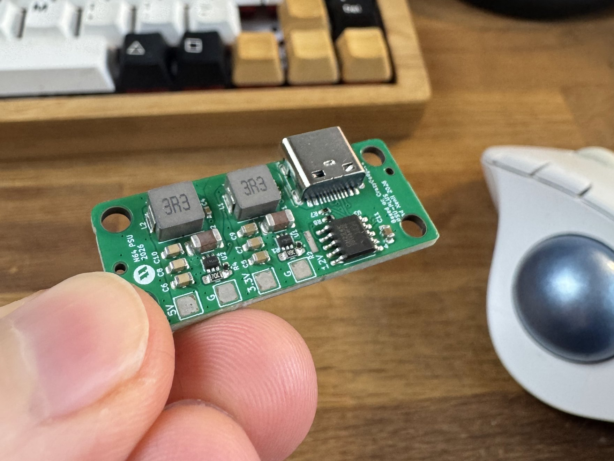
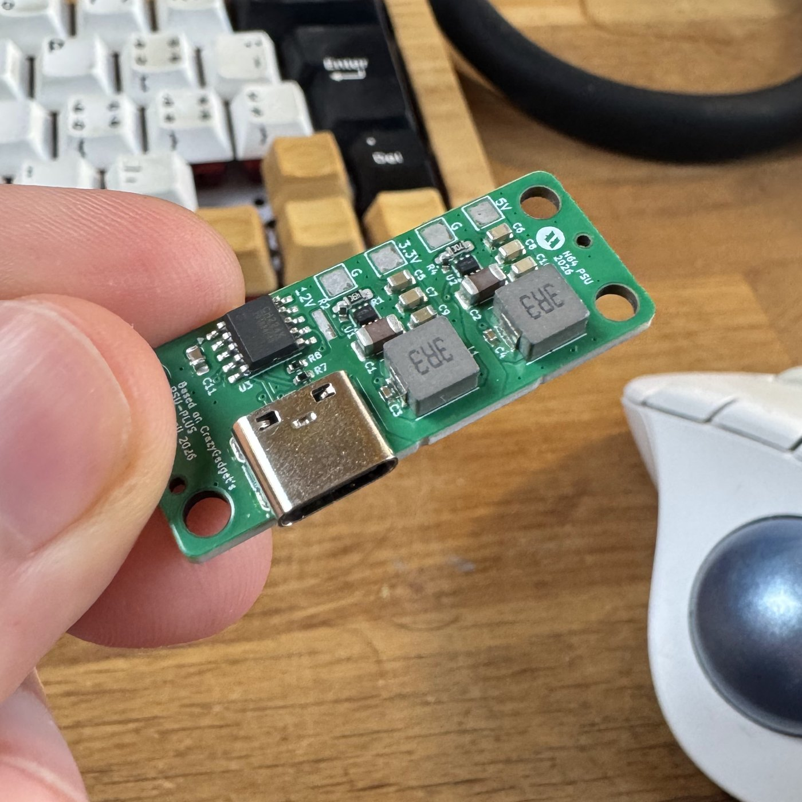
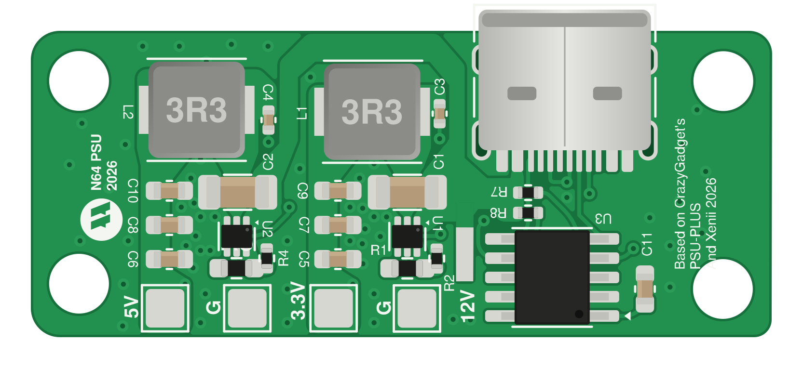
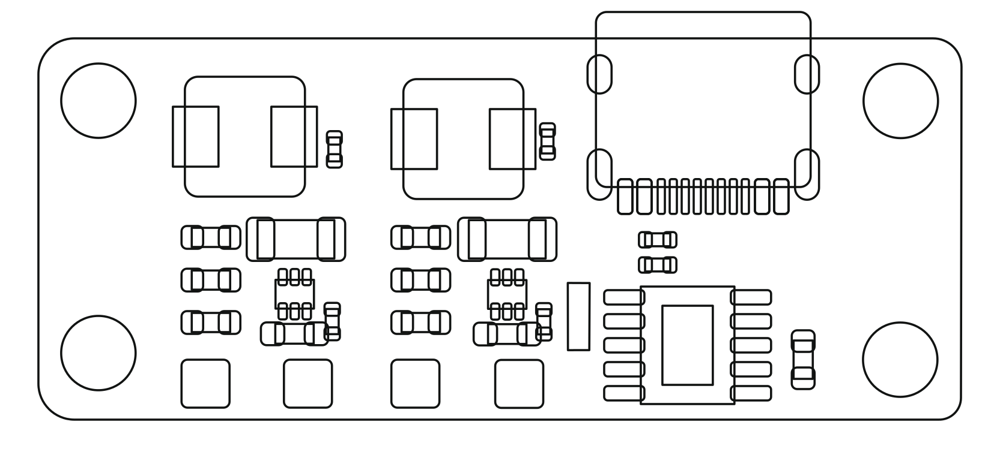
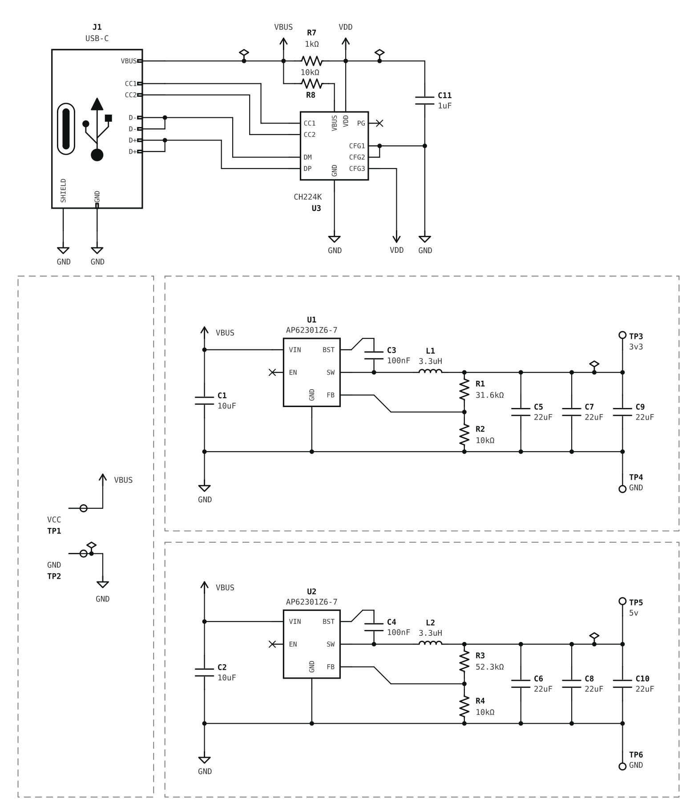
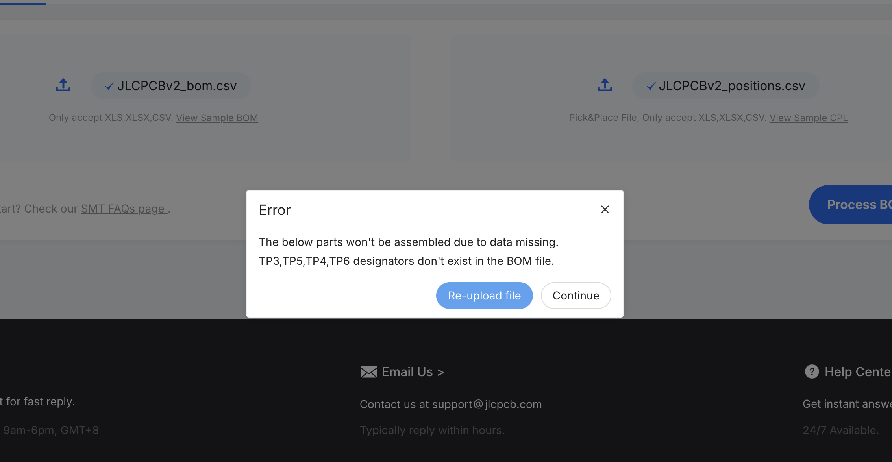
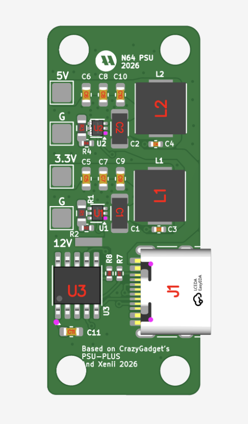

# N64 USB-C Power Delivery 🔌

Salut les bidouilleurs et les makers !

J’ai travaillé sur ce petit PCB à la base pour mon projet de Nintendo 64 custom : l’idée était de pouvoir alimenter la console en USB-C, avec du **12 V, du 5 V et du 3,3 V** disponibles sur la carte. Je partage ici les fichiers KiCad et les fichiers de fabrication pour que vous puissiez regarder comment c’est fait et vous en inspirer pour vos propres bidouilles.

Le PCB a été retravaillé à partir des travaux de **Xenii2026** et de **CrazyGadget**, notamment le **PSU-PLUS**. Merci à eux pour les bases du projet !

## Comment ça fonctionne ?

Le principe : utiliser un chargeur **USB-C Power Delivery compatible avec un profil 12 V**. Le contrôleur **CH224K** s’occupe de la négociation avec le chargeur, puis deux convertisseurs **AP62301Z6-7** abaissent cette tension pour obtenir le 5 V et le 3,3 V.

```text
Chargeur USB-C PD compatible 12 V
              │
       CH224K : négociation
              │
             12 V ───────────────► sortie 12 V
              ├── AP62301 ───────► sortie 5 V
              └── AP62301 ───────► sortie 3,3 V
```

Le 12 V vient donc du chargeur après négociation ; le 5 V et le 3,3 V sont générés sur le PCB. Un chargeur USB-C ne propose pas forcément le profil 12 V : pensez à vérifier le vôtre.

La N64 a été le point de départ, mais ces trois tensions peuvent aussi donner des idées pour d’autres projets de makers. À vous de vérifier que les besoins de votre montage correspondent aux capacités de la carte.

## La carte en images

La carte assemblée, côté pastilles de raccordement :



Et côté USB-C :



### Rendu et routage





### Schéma complet



[Ouvrir le schéma en SVG](docs/images/schema-complet-noir.svg)

## Ce que vous trouverez ici

| Fichier ou dossier | À quoi ça sert |
|---|---|
| `hardware/` | Le projet KiCad, le schéma et le PCB pour explorer ou modifier la carte |
| `production/JLCPCBv2.zip` | Les Gerbers et les fichiers de perçage |
| `production/JLCPCBv2_bom.csv` | La BOM par carte, avec les références LCSC |
| `production/bom.xls` | La BOM Excel source fournie pour la commande |
| `production/JLCPCBv2_positions.csv` | Les positions et rotations des composants |
| `docs/images/N64-PSU.svg` | Le schéma consultable directement |
| `docs/PCB-INVENTORY.md` | Les composants et les connexions du PCB |
| `docs/VALIDATION.md` | Les vérifications et les points à compléter |
| `SOURCE-SHA256.txt` | Les empreintes de contrôle des sources et fichiers de production |

[Voir le schéma](docs/images/N64-PSU.svg) · [Voir les points à vérifier](docs/VALIDATION.md)

## Envie de mettre les mains dedans ?

Ouvrez `hardware/N64-PSU.kicad_pro` avec **KiCad 10**. Le PCB est en deux couches, avec une épaisseur déclarée de **1,6 mm**. Certaines bibliothèques personnelles et certains modèles 3D externes ne sont pas inclus ; les détails sont dans la documentation.

Quelques repères pour vous y retrouver :

- **J1** : entrée USB-C.
- **U3** : contrôleur CH224K.
- **U1 + L1** : conversion vers le 3,3 V, accessible sur **TP3**.
- **U2 + L2** : conversion vers le 5 V, accessible sur **TP5**.
- **TP4 et TP6** : masse.

## Avant de commander ou de brancher

La BOM contient **23 composants par carte**, avec les **références LCSC renseignées** à partir du fichier fourni le 23 novembre 2026. Utilisez [JLCPCBv2_bom.csv](production/JLCPCBv2_bom.csv) pour l’assemblage. Le [fichier Excel source](production/bom.xls) est aussi disponible : sa colonne Qty correspond aux quantités de commande, pas aux quantités à monter sur une seule carte.

### Le message « composants manquants » pour TP3 à TP6

Si JLCPCB indique que **TP3, TP4, TP5 et TP6 n’existent pas dans la BOM**, c’est normal : ce sont les **pastilles de test ou de soudure**, pas des composants à acheter et à assembler. Elles sont présentes dans le fichier de placement, mais volontairement absentes de la nomenclature. Vous pouvez continuer si le message concerne uniquement ces quatre repères. Si d’autres composants sont signalés, vérifiez leur correspondance.



### Vérifiez bien le sens des composants !

Dans l’aperçu d’assemblage JLCPCB, contrôlez que le **repère violet d’orientation** correspond au repère de la broche 1 sur la sérigraphie du PCB. Sur ma commande, **U1 et U2 ont nécessité une correction de rotation dans l’aperçu**. Comparez avec l’image ci-dessous avant de valider, et contrôlez aussi les autres composants orientés.



Cette capture sert de référence visuelle. Les rotations du fichier de placement fourni n’ont pas été modifiées : le sens doit être vérifié dans l’aperçu du fabricant, sans appliquer un angle au hasard.

Prenez le temps de contrôler les pièces choisies, les rotations et la cohérence des fichiers de fabrication avec votre version du PCB. Avant de brancher une console, mesurez les tensions et vérifiez le câblage. Les courants disponibles et les résultats thermiques ne sont pas encore documentés ici.

Les remarques techniques et les contrôles du projet sont regroupés dans [VALIDATION.md](docs/VALIDATION.md).

## Crédits et partage

Ce projet s’appuie sur le travail de **Xenii2026** et de **CrazyGadget / PSU-PLUS**. La sérigraphie conserve la mention « Based on CrazyGadget’s PSU-PLUS And Xenii 2026 ».

Si vous repérez une amélioration, adaptez la carte à un autre montage ou avez des retours de fabrication, venez les partager dans les issues ! C’est aussi comme ça qu’on fait avancer les projets entre makers.

Aucune licence de redistribution n’est définie pour le moment ; les licences des projets d’origine restent à vérifier avant d’en choisir une. Projet indépendant, sans affiliation avec Nintendo.

